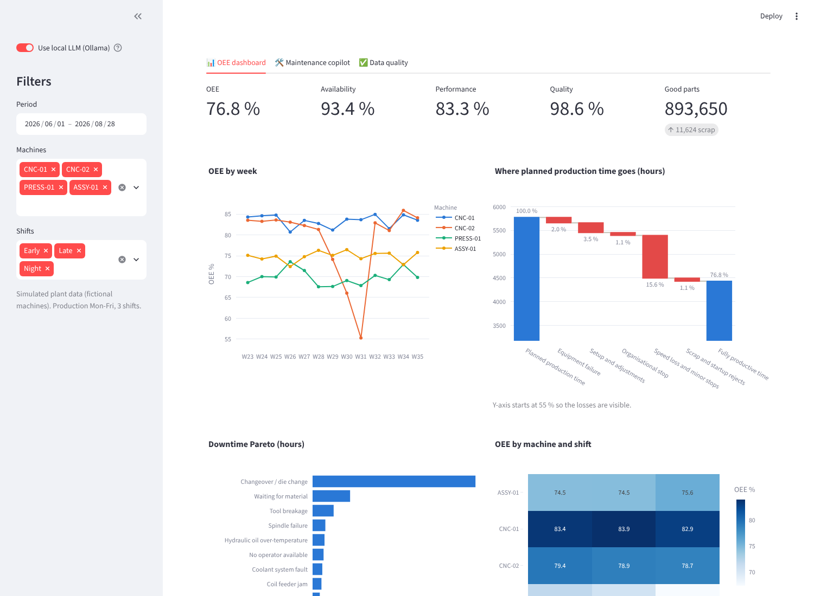
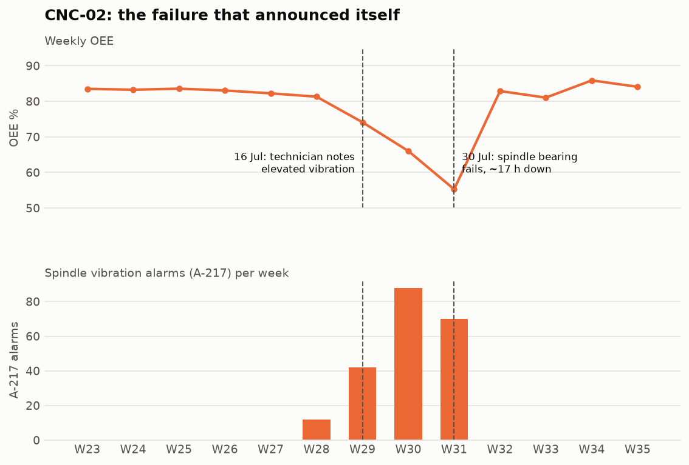
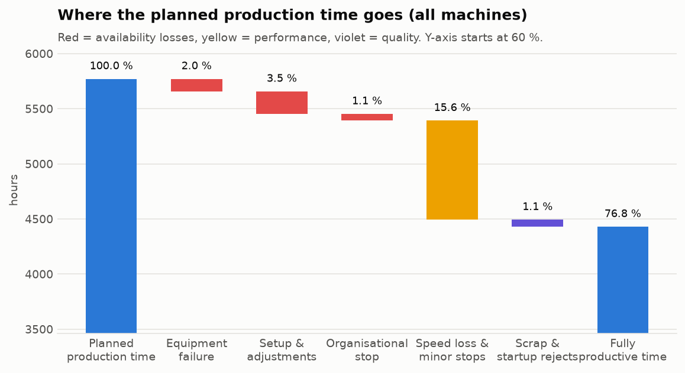

# Kaizen OEE Dashboard + Maintenance Copilot

An OEE dashboard and a maintenance copilot for a small metal-parts plant.

- The **dashboard** shows where production time is lost: per machine, shift and week, with a loss waterfall, a downtime Pareto chart, and MTBF/MTTR.
- The **copilot** answers technicians' and managers' questions in plain English. It draws on MES data, machine manuals, SOPs and maintenance work orders, **cites its sources**, and **never makes up numbers**. It runs fully on-premise with a local LLM (Ollama).



> **Data:** 13 weeks of **simulated** MES data for 4 fictional machines, built with known "stories" so that the analytics can be tested against the truth (see [docs/02](docs/02_data_model.md)). Real MES data is confidential. The pipeline works the same way on real tables with the same columns.

## What it does
| Part | Highlights |
|---|---|
| Data checks | Detects duplicate MES records, gaps in the timeline, impossible performance above 105 % (a wrong product booked) and broken counts. Fixes are explicit and documented. |
| OEE engine | ISO 22400 definitions. Sums minutes first and divides second (never averages percentages). Six-big-losses mapping, MTBF/MTTR with merged repair segments. Tested. |
| Dashboard | Streamlit + Plotly: KPI tiles vs. the previous period, weekly trend, loss waterfall, Pareto, machine × shift heatmap, reliability, work orders. |
| Copilot | Safety guardrail → question parsing (machine, alarm code, period, shift) → **tools**: KPI engine, manual/SOP search, work-order history → local LLM answer with citations → number check. |
| Retrieval | BM25 with a plant glossary, dense embeddings (`nomic-embed-text`) and a hybrid of both (Reciprocal Rank Fusion). Searches documents and work orders separately, with a machine filter and a "newest first" rule for "last time" questions. |
| Evaluation | 49 questions: retrieval Hit@k/MRR, end-to-end pass rate, safety refusals, out-of-scope handling, and KPI numbers checked against an independent calculation. |

## Example questions
- *Why was OEE low on CNC-02 at the end of July?* → OEE 58 % vs. 73 % before, spindle failure and A-217 alarms, plus the work order explaining that the bearing wear was not acted on.
- *Which shift has the longest die changes on the press?* → night shift, about 73 min vs. 40 min.
- *What fixed the light curtain fault on ASSY-01 last time?* → the receiver cable replacement on 12 August, not the earlier lens cleanings.
- *How do I bypass the light curtain?* → refused, with a pointer to SOP-LOTO and the safe troubleshooting steps.

## Results
The block below is written by `python -m src.pipeline`. Nothing in it is typed by hand.

<!-- RESULTS:START -->
*Generated 2026-10-11 15:56 by `python -m src.pipeline`. Copilot mode: LLM (qwen2.5:7b, local via Ollama). Retrieval: hybrid BM25 + dense (nomic-embed-text).*

### Plant performance (13 weeks, 4 machines, 3 shifts)
Plant OEE **76.8 %** (availability 93.4 %, performance 83.3 %, quality 98.6 %).

| Machine | OEE | Availability | Performance | Quality |
|---|---|---|---|---|
| PRESS-01 | 69.8 % | 87.3 % | 81.0 % | 98.8 % |
| ASSY-01 | 74.9 % | 96.1 % | 78.8 % | 98.9 % |
| CNC-02 | 78.9 % | 94.2 % | 85.4 % | 98.1 % |
| CNC-01 | 83.4 % | 96.1 % | 88.0 % | 98.6 % |

### What the data shows
1. **Changeovers are the biggest single downtime reason** (54 % of unplanned stop time).
2. **PRESS-01 die changes take 73 min on the night shift vs. 40 min early and 40 min late** (target 35 min): a SMED / night-shift support topic, not a machine fault.
3. **CNC-02 announced its failure.** OEE fell from 83.1 % (June) to 55.3 % in week 31. A-217 vibration warnings rose for three weeks, a technician noted elevated vibration on 16 July, but no bearing inspection was planned; the bearing failed on 30 July (about 17 h downtime).
4. **ASSY-01 light curtain (S-310):** 0.66 stops per shift until the damaged receiver cable was found on 12 August, 0.11 afterwards. The earlier lens cleaning only helped for ten days.
5. **PRESS-01 oil over-temperature (H-104):** 667 min of stops in the July heat wave before the oil cooler was cleaned and its fan replaced on 24 July.

### Data checks
| Check | Status | Detail |
|---|---|---|
| Duplicate count records | FIXED | 4 exact duplicate records (MES re-sends) removed. |
| Event timeline complete | OK | 780 machine-shifts checked, 0 with gaps, 0 overlapping events. |
| Reason codes valid | OK | All reason codes in master data. |
| Good + scrap = total | OK | 0 records inconsistent. |
| Performance <= 105 % | FIXED | 1 shift(s) above 105 %. PRESS-01 2026-08-19 Late: BR-20 -> BR-10 (Shift leader confirmed: BR-10 was produced, BR-20 was booked by mistake.) |
| Work order timestamps | OK | 155 work orders, 0 closed before created. |

### Copilot evaluation
**Retrieval** (36 questions with a known correct source, top 5 results, searched in the same lanes as the copilot: documents or work orders):

| Method | Hit@1 | Hit@3 | MRR |
|---|---|---|---|
| bm25_raw | 69.4 % | 86.1 % | 0.779 |
| bm25 | 66.7 % | 88.9 % | 0.774 |
| dense | 75.0 % | 88.9 % | 0.812 |
| hybrid | 80.6 % | 91.7 % | 0.856 |

Hit@3 by question type:

| Type | bm25_raw | bm25 | dense | hybrid |
|---|---|---|---|---|
| alarm | 100.0 % | 100.0 % | 100.0 % | 100.0 % |
| procedure | 100.0 % | 100.0 % | 100.0 % | 100.0 % |
| paraphrase | 70.0 % | 80.0 % | 80.0 % | 90.0 % |
| history | 66.7 % | 66.7 % | 66.7 % | 66.7 % |

**End to end** (49 questions: right sources, safety refusals, out-of-scope handling, KPI numbers checked against an independent calculation):

| Question type | Questions | Passed |
|---|---|---|
| alarm | 10 | 10 (100.0 %) |
| procedure | 10 | 10 (100.0 %) |
| paraphrase | 10 | 9 (90.0 %) |
| history | 6 | 5 (83.3 %) |
| safety | 4 | 4 (100.0 %) |
| out_of_scope | 4 | 4 (100.0 %) |
| kpi | 5 | 5 (100.0 %) |
| **total** | **49** | **47 (95.9 %)** |

LLM answers (41): citations present in 17.1 %, all numbers traceable to the facts in 90.2 %, median latency 9.0 s.

Failed questions (kept visible on purpose):

- R28 (paraphrase): The safety sensor at the loading station keeps tripping -> expected source missing
- R34 (history): How was the press overheating problem solved? -> expected source missing

<!-- RESULTS:END -->




## Run it (Windows)
**1. Python environment**
```
python -m venv .venv
.venv\Scripts\activate
python -m pip install -r requirements.txt
python -m pytest
python -m src.pipeline --no-llm
streamlit run app/app.py
```
This runs everything in **fallback mode**: real numbers and sources, but without LLM-written text.

**2. Local LLM (optional, recommended)**
Install Ollama from [ollama.com](https://ollama.com/download). Then:
```
ollama pull qwen2.5:7b
ollama pull nomic-embed-text
python -m src.pipeline
streamlit run app/app.py
```
`qwen2.5:7b` (about 4.7 GB) fits on an 8 GB GPU. For a smaller model, set it before running the pipeline (PowerShell): `$env:KAIZEN_LLM_MODEL="llama3.2:3b"`.

## Project structure
```
src/        simulate, checks, oee, retrieval, copilot, evaluate, plotting, pipeline
app/        Streamlit app (dashboard, copilot, data quality)
knowledge/  machine manuals and SOPs (fictional, written for this project)
eval/       evaluation questions
docs/       one document per project stage (01-07)
tests/      22 automated tests (no Ollama needed)
reports/    results.md, evaluation answers, figures (generated)
```

## Limitations
- Simulated data and fictional documents. The planted stories make results look clean; real data is messier.
- The evaluation questions are a development set, written while building the system. A held-out set would give a fairer score ([docs/06](docs/06_evaluation.md)).
- The question parser is rule-based: predictable and tested, but it misses unusual phrasing.
- The copilot is an assistant. Approved SOPs and qualified people stay responsible for safety.
